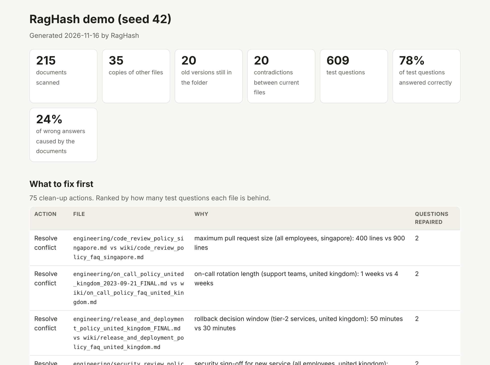
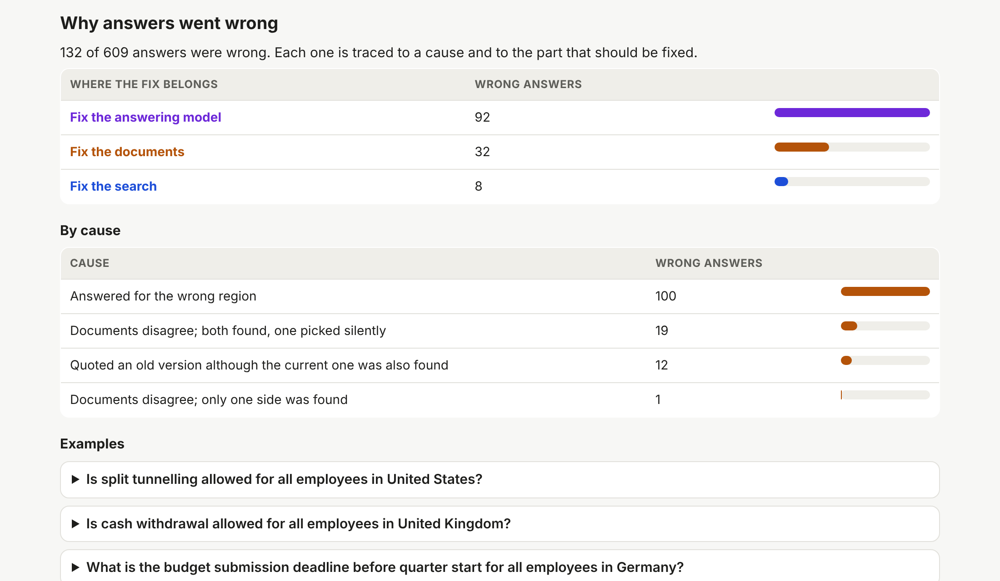

# RagHash

[](https://github.com/balamandula-bit/raghash/actions/workflows/tests.yml)
 

**When a RAG system gives a wrong answer, is it the documents, the search, or the model?**

RAG evaluation tools tell you an answer is wrong. RagHash tells you *why*, and which files to fix first. It scans a
document folder for copies, superseded versions and contradictions, builds a test set that follows the documents as they
change, and traces every wrong answer to a cause and an owner.



## Why this exists

In a company, the same policy lives in a wiki page, a PDF and an old copy on a shared drive. Someone updates one of
them. The RAG system then quotes the stale one, or the FAQ that disagrees with the policy, and the team spends days
tuning prompts and embeddings for a problem that is in the documents. Evaluation frameworks score answers; none of them
look at the health of the corpus the answers come from.

## What it does

| Step | Module | Finds |
|---|---|---|
| Read | `reader` | title, owner, version, dates (written, in the file name, or only the file's modified time) |
| Copies | `duplicates` | exact and near-identical files (MinHash + LSH, with a guard that keeps a changed number from counting as "the same") |
| Versions | `versions` | which file replaced which, with a confidence, and an "undetermined" list instead of a guess |
| Contradictions | `contradictions` | two current files giving different values for the same fact, scope and region; never flags a different scope or region |
| Test set | `testset` | one question per fact, with the right answer and the wrong answers worth watching for; `diff` lists the questions to re-answer after documents change |
| Diagnosis | `diagnose` | every wrong answer gets a cause (9 kinds) and an owner: documents, search or model |
| Report | `report` | one self-contained HTML page: what to fix first, ranked by questions repaired |

```
documents ──> Reader ──> Copies ──> Versions ──> Contradictions ──> Test set ──┐
                                                                               ├──> Diagnosis ──> Report
your RAG's answers + what it retrieved ────────────────────────────────────────┘
```



## Try it in 60 seconds

```bash
git clone https://github.com/balamandula-bit/raghash.git
cd raghash
python -m raghash.demo          # no installs needed; writes raghash_demo/report.html
python -m pip install pytest && python -m pytest -q      # 104 tests
```

The demo makes a practice corpus with a hidden answer key, scans it, scores the scan against the key, builds the test
set, runs a plain BM25 RAG baseline, diagnoses it and writes the report. About 20 seconds, Python 3.9+, no dependencies.

To scan your own folder of `.md` / `.txt` files: `python -m raghash.report path/to/docs --out report.html`.

To diagnose your own system, give it the generated test set and write its output as
`{"Q-id": {"answer": "...", "retrieved": ["path/to/doc.md", ...]}}`, then run `python -m raghash.report <corpus> --answers answers.json --out report.html`.

## Results (practice corpus, 215 documents, repeated on several random seeds)

| Check | Result |
|---|---|
| Copies | 35 of 35 found, 0 false alarms |
| Version order | 20 of 20 correct, 0 reversed |
| Contradictions | 20 of 20 found, 0 false alarms (10 scope traps and 10 consistent restatements left alone) |
| Test set drift | documents changed, exactly the questions behind them flagged (5 of 609 on seed 42), nothing else |
| Diagnoser | 8,412 deliberately injected failures, 0 wrong cause or owner |
| Baseline RAG | 78.3% correct; 24% of its wrong answers trace to the documents, 100 are wrong-region answers |

## How it is tested

The practice corpus is generated with an answer key, so every claim above is scored, not eyeballed: a pair outside the
key counts as a false alarm, a version pair in the wrong order is counted separately. The diagnoser is checked by
`synth/faulty_rag.py`, a fake RAG that fails on purpose in each of the 9 ways so the right cause is known in advance.
`synth/drift.py` simulates documents changing to check the test-set diff.

## Honest limits

- The corpus is synthetic, short and templated. Perfect scores here show the logic is right on this data, not that it
  will be perfect on yours.
- Facts are read with patterns that match the practice corpus. A real deployment needs a stronger reader (an LLM
  extractor) for step one; everything after it stays the same.
- File modified times can lie when a file is re-saved, so versions ordered only by them are marked lower confidence.
- Only `.md` and `.txt` for now; PDF and DOCX would be next.
- The baseline RAG is deliberately simple. It exists to have something to diagnose.
- On a yes/no question, a flipped answer looks the same as quoting another scope's value from the same policy; the
  diagnoser reports it as scope confusion (both blame the answering model).

---

# Reference

Per-module details and the exact commands.

## The practice corpus

120 clean base documents (24 policy topics x 5 regions, across HR / IT / Finance / Engineering), plus fault documents.
Each base document is used by at most one fault, so labels are never ambiguous.

| Fault | Count | What it is | Expected detector behaviour |
|---|---|---|---|
| `exact_duplicate` | 15 | Byte-identical copy, different name or folder | Flag as duplicate |
| `near_duplicate` | 20 | Same facts; typos, one reworded sentence, whitespace noise | Flag as duplicate |
| `version_pair` | 20 | v2 of a document: 1-2 values changed, later date, v1 left in place | Order old to new, mark v1 superseded |
| `contradiction` | 20 | An FAQ page states a different value for a fact in the policy | Flag as conflict |
| `scope_trap` | 10 | FAQ gives a different value for the same subject but a different scope | **Do not** flag |
| `consistent_restatement` | 10 | FAQ restates facts in different words, same values | **Do not** flag |

The remaining 25 base documents are untouched. A fact is identified by `(topic, subject, scope, region)`;
region is part of the scope, so two regions with different values are not a conflict.

The date of a document is visible in only one way: in the text (70%), in the file name (15%), or only in the
file modification time (15%). The true date is always in the manifest.

## Layout

```
data/synth_v1/
  corpus/                 <- the ONLY thing a scanner may read
  ground_truth/
    manifest.jsonl        one row per document: true date, facts, role, fault ids
    labels.json           every injected fault
```

A label looks like this:

```json
{"type": "contradiction", "id": "F056",
 "docs": ["finance/expense_policy_singapore.md", "wiki/expense_policy_faq_singapore.md"],
 "fact": {"topic": "Expense Policy", "subject": "expense approval limit", "scope": "directors", "region": "Singapore"},
 "values": {"finance/expense_policy_singapore.md": "8200 USD", "wiki/expense_policy_faq_singapore.md": "8400 USD"},
 "severity": "numeric"}
```

## Scoring a detector

Write predictions as JSON (paths relative to `corpus/`):

```json
{"duplicates": [["a.md", "b.md"]], "versions": [["old.md", "new.md"]], "contradictions": [["a.md", "b.md"]]}
```

```bash
python -m raghash.evaluate --truth data/synth_v1/ground_truth --pred predictions.json
```

Scoring is strict: a pair outside the truth set is a false positive, and `fp_breakdown` says what it really was
(for example a scope trap or a version pair). Version pairs are ordered, and a correct pair in the wrong order is
reported separately as `wrong_order`.

## Limitations of the practice corpus

- Documents are short (median 215 words) and use templated wording. Real corpora are longer and messier.
- File modification times are always truthful. Real ones lie when a file is re-saved.
- Only `.md` and `.txt`. PDF and DOCX parsing comes later.

## Reader

`raghash/reader.py` opens every `.md` / `.txt` file and returns one uniform record per document:
normalised text, title, header fields (policy code, owner, applies to, version), sections, hashes, and
every date clue (written in the text, written in the file name, file modified time). `best_date` picks
text first, then file name, then mtime, and `date_source` says which one it used.

```bash
python -m raghash.reader data/synth_v1/corpus --out data/synth_v1/parsed.jsonl
python -m raghash.reader_check --corpus data/synth_v1/corpus --truth data/synth_v1/ground_truth
```

`reader_check` scores the Reader against the answer key. One finding to carry forward: for a copied file whose
only date clue is its modified time, that time is the day the copy was made, not the document's date.
Later steps must not trust mtime on copies.

## Duplicate finder

`raghash/duplicates.py` finds duplicate pairs in three steps: **exact** (same bytes), **same_text** (same after
the Reader cleans spaces), and **near** (word 3-gram similarity of at least 0.7 *and* the same numbers and decision
words such as "required" or "not allowed"). `minhash.py` (MinHash + LSH, pure Python) picks the pairs worth
comparing: about 600 of the 23,000 possible on the practice corpus.

Similar pairs whose numbers or decision words differ are not duplicates. A limit changed, or "allowed" became
"not allowed". They go to `revision_candidates` for the Version finder. Similarity alone cannot separate the two kinds:
near-copies score 0.78 and up, revisions 0.77 to 0.97.

```bash
python -m raghash.duplicates data/synth_v1/corpus --out data/synth_v1/pred_duplicates.json
python -m raghash.evaluate --truth data/synth_v1/ground_truth --pred data/synth_v1/pred_duplicates.json
```

Result on 12 different practice corpora: all 35 planted duplicates found each time, no false duplicates, and every
version pair handed on to the Version finder. The 0.7 threshold sits between the closest non-duplicate pair (0.64) and the
lowest near-copy (0.78). The practice text is templated, so expect a narrower gap on real documents.

## Version finder

`raghash/versions.py` takes the `revision_candidates` from the Duplicate finder and decides which file is newer. Steps: keep only
pairs that are the same document (same title or policy code); collapse duplicate copies into one group so a re-saved
copy cannot pose as a newer version; date each group (text, then file name, then the group's earliest modified time);
order oldest to newest, using the version label only to break ties. Each link gets a confidence: **high** (two real
dates), **medium** (one date is a modified time), **low** (version label only, or date and label disagree). A set that
cannot be ordered goes to `undetermined` instead of being guessed.

```bash
python -m raghash.versions data/synth_v1/corpus --out data/synth_v1/pred_versions.json
python -m raghash.evaluate --truth data/synth_v1/ground_truth --pred data/synth_v1/pred_versions.json
```

Result on 11 different practice corpora: all 20 version pairs ordered correctly each time, no wrong order, nothing
undetermined. On seed 42, 6 links are high confidence and 14 medium (their dates come from modified times).

## Contradiction finder

`raghash/contradictions.py` reads every document into claims, a fact key `(topic, subject, scope, region)` with a
value, from table rows, bullets, FAQ question/answer pairs and plain sentences. It drops files the Version finder marked
superseded and extra copies from the Duplicate finder, then flags two current documents that give different values for the same key.
Because scope and region are in the key, "tier-1 vs tier-2" or "India vs Germany" is never flagged. Values compare as
numbers with units (`5 years` equals `60 months`) or as decisions (`allowed` vs `not allowed`). Values in units that
cannot be converted go to `incomparable`; a file that disagrees with itself goes to `internal`.

```bash
python -m raghash.contradictions data/synth_v1/corpus --out data/synth_v1/pred_contradictions.json
python -m raghash.evaluate --truth data/synth_v1/ground_truth --pred data/synth_v1/pred_contradictions.json
```

Result on 13 different practice corpora: all 20 planted contradictions found each time, no false positives (the 10
scope traps and 10 consistent restatements are left alone). A test also checks that the extractor reproduces every
fact in the answer key, document by document.

Honest limit: the extractor knows the sentence shapes of the practice corpus, so 100% here proves the logic after
extraction, not the extraction itself. Real documents need an LLM or trained extractor in step 1; the rest stays.

## Test question maker

`raghash/testset.py` turns the corpus into a test set that follows it. One question per fact the current
documents state, each with the correct answer and the wrong answers worth watching for, each wrong answer tagged with why:

| Type | Meaning | Correct behaviour |
|---|---|---|
| `fact` | one current value | give it |
| `stale_trap` | an older version said something else | give the current value (the old one = stale answer) |
| `conflict` | two current documents disagree | flag the conflict, do not pick one |

Distractors are `stale`, `other_scope` and `other_region` values for the same subject. Question ids come from the fact
key, so after documents change you rebuild and `diff` lists exactly the questions that need a new answer. `grade`
sorts a system's answers into outcomes: `correct`, `stale_answer`, `other_scope_answer`, `other_region_answer`,
`conflict_flagged`, `conflict_missed`, `hedged`, `wrong`, `no_answer`.

```bash
python -m raghash.testset build data/synth_v1/corpus --out data/synth_v1/testset.json
python -m raghash.synth.drift --corpus data/synth_v1 --out data/synth_v2 --n 5     # 5 documents get a new version
python -m raghash.testset build data/synth_v2/corpus --out data/synth_v2/testset.json
python -m raghash.testset diff data/synth_v1/testset.json data/synth_v2/testset.json
```

On seed 42: 609 questions (559 fact, 30 stale traps, 20 conflicts). The conflict questions are exactly the 20 planted
contradictions and the stale traps exactly the changed facts of the 20 version pairs. After the drift step the diff
shows 5 questions changed out of 609, the 5 that were drifted, and nothing else.

Limits: answers are graded by reading numbers and yes/no words, which is enough for short answers but not for long
free text; a yes/no answer that narrates both values ("it was not allowed but is now allowed") is ambiguous.

## Failure diagnoser

`raghash/diagnose.py` takes the test set and a system's answers **with what it retrieved**, and gives every
wrong answer one cause and one owner:

| Cause | Meaning | Blame |
|---|---|---|
| `stale_source_only` / `stale_beat_current` | the system quoted a superseded file (alone, or next to the current one) | corpus |
| `conflict_hidden` / `conflict_ignored` | two current files disagree; only one side retrieved, or both and it picked one | corpus |
| `duplicate_crowding` | copies of documents filled the top results and the needed one was missing | corpus |
| `scope_confusion` / `region_confusion` | it quoted another scope's or region's value | generator if the right file was in front of it, else retriever |
| `generation_error` | the right file was retrieved and the answer is still wrong | generator |
| `retrieval_miss` | the needed file never reached the model | retriever |

The point: Ragas-style tools say an answer is wrong; this says whether to fix the documents, the retriever or the
model, and lists the files to fix first (`files_to_fix`, ranked by questions affected).

```bash
python -m raghash.baseline data/synth_v1/testset.json data/synth_v1/corpus --out data/synth_v1/answers.json
python -m raghash.diagnose data/synth_v1/testset.json data/synth_v1/answers.json --corpus data/synth_v1/corpus --out data/synth_v1/diagnosis.json
```

`baseline.py` is a plain BM25 + rule-based RAG that stands in for the system you want to diagnose. Your own system only
has to write the same file: `{"Q-id": {"answer": "...", "retrieved": ["path", ...]}}`.

On seed 42 the baseline gets 78.3% (132 wrong): 100 region confusions, 19 + 1 ignored/hidden conflicts and 12 stale
answers; 24% of the failures trace to the corpus. How the diagnoser is checked: `synth/faulty_rag.py` breaks answers on
purpose in each of the 9 ways, so the right cause is known in advance. Across 10 corpora that is 8,412 injected failures
with no wrong cause or blame. This checks the rules, not real RAG behaviour.

Known ambiguity: on a yes/no question, a flipped answer looks the same as quoting another scope's value held in the same
policy, so the diagnoser reports `scope_confusion` rather than `generation_error` there. Both blame the generator.

## Report

`raghash/report.py` runs the whole pipeline and writes one self-contained HTML file (no internet, no scripts,
works on a phone, follows light/dark mode) plus the same data as JSON beside it.

```bash
python -m raghash.report data/synth_v1/corpus --answers data/synth_v1/answers.json --previous data/synth_v1/testset.json --title "Practice corpus" --out data/synth_v1/report.html
```

Sections: headline numbers; **What to fix first** (retire this old version, remove this copy, resolve this conflict,
ranked by how many test questions each file is behind when `--answers` is given); why answers went wrong, by cause and
by who should fix it, with worked examples; corpus health (contradictions side by side, old versions with confidence,
copies); the test set, and with `--previous` what changed since. Every piece of text from a document is HTML-escaped.
On seed 42 it lists 75 actions: 20 conflicts, 20 old versions, 35 copies.

## What's next

- An LLM-based claim extractor, so the contradiction finder works on free-form documents
- PDF and DOCX parsing
- A ready-made adapter for LangChain / LlamaIndex pipelines to produce `answers.json`
- Real-world corpora to replace the synthetic one

## Author

Built by [M. Bala Narasimha Swamy](https://www.linkedin.com/in/bala-mandula) (Hyderabad). MIT licensed.
